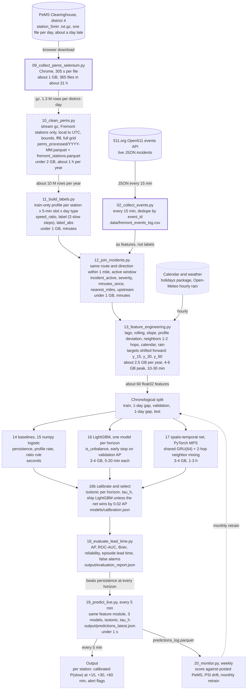

# Fremont Bottleneck Predictor: plan for a local model on a 16 GB M1 Mac mini

_September 2026. Companion to `05_PLAN_COMBINED_DATASETS.md` and the data-flow reference. Script numbers follow that reference's renumbering (10–18 planned); 16b, 19 and 20 are new here._

**Slowdowns on I‑880, I‑680 and SR‑84, called 15 to 60 minutes ahead, from one 16 GB M1 Mac mini.**

The model scores every mainline detector station in Fremont every five minutes and returns a calibrated probability that the station will be inside a slow episode 15, 30 and 60 minutes from now. It learns from PeMS 5-minute detector history, the 511.org incident log this repo already collects, a holiday calendar and hourly rain. Everything below runs on the Mac mini; the numbers are budgeted against its 16 GB of unified memory.

## At a glance

| | | |
|---|---|---|
| Stations | **≈100** | mainline detectors on I-880, I-680 and SR-84, both directions. Count them from the meta file. |
| Rows per year | **≈10 M** | 100 stations × 288 steps × 365 days, after filtering the district file. |
| Feature table | **≈2.5 GB** | per year on disk, about 60 float32 columns. Two years still fit. |
| Tree training | **5–20 min** | per horizon in LightGBM, 8 threads, 3–4 GB peak. |
| One prediction cycle | **<1 s** | 100 stations × 3 horizons, every 5 minutes. |
| PeMS delay | **≈1 day** | the Clearinghouse posts yesterday. The live loop needs another speed feed. |

_Estimates, derived from the documented PeMS file layout and the station spacing on these routes. Measure the first real file and replace them._

## The flowchart

Solid outline: built. Dashed: planned in the reference. Dotted: new in this plan. The cylinders are external sources.



## Stages, in order

### Stage 1 · external · `511.org API`

**Open511 events feed**

**Input.** An HTTPS GET built by `02_collect_events.py`: `/traffic/events?api_key=…&format=json&status=active|archived`.

**Does.**

1. Returns JSON with an `events` list: `id`, `event_type`, `severity`, `status`, `headline`, `created`, `updated`, `roads[]`, `geography`.
2. Held in memory inside the collector; nothing lands on disk at this stage.

**Output.** Live JSON, Open511 shape.

**On the M1.** Negligible. The API key carries a request quota; one call every 15 minutes is far inside it.

### Stage 2 · built · `02_collect_events.py`

**Clean and filter 511 events**

**Input.** The raw `events` list from stage 1.

**Does.**

1. `event_touches_fremont()` keeps events on a Fremont road name or inside the bounding box (lat 37.447–37.612, lon −122.075 to −121.888).
2. `flatten_event()` turns nested JSON into one row; multiple roads join with `; `.
3. `load_existing_ids()` and `append_rows()` dedupe on `event_id` and stamp `pulled_at`.
4. Runs once with `--bootstrap` (archived, capped at 1000) and then every 15 minutes.

**Output.** `data/fremont_events_log.csv`: event_id, event_type, severity, status, headline, created, updated, road_names, directions, lat, lon, pulled_at.

**On the M1.** Under 100 MB, seconds per poll. Schedule it with launchd, not cron, so it survives sleep and reboots; set the Mac to never sleep.

**Keep or change.**

- Also write each poll's raw JSON to `data/events_raw/YYYY-MM-DD.jsonl`. The join rules in stage 7 will change; raw lets you rebuild the incident features without re-polling.
- Record `first_seen_at` and `last_seen_at` per event id from polling. In the live loop you only know an incident ended when it stops appearing; `updated` is a hindsight field.
- Keep events with a matching road name but no `geography`, and set `geo_missing = 1` instead of dropping them.

### Stage 3 · built · `03_train_from_scratch.py · 04_predict_live.py`

**The v1 incidents-only model**

**Input.** `data/fremont_events_log.csv`.

**Does.**

1. Builds the 3 × 24 × 2 grid of road × hour × weekend, marks 1 where any event ever occurred, fits a hand-rolled logistic regression.
2. `04_predict_live.py` scores the current hour for the three roads and prints it next to live incidents.

**Output.** `models/bottleneck_weights.npz` (weights, bias, feature_names).

**On the M1.** Trivial. 144 rows.

**Keep or change.**

- Keep it as the teaching baseline. It is a lookup table dressed as a model: with 144 cells and no history it cannot say anything about the next 30 minutes. In the new pipeline it becomes one row in the baseline table of stage 9.

### Stage 4 · built · `09_collect_pems_selenium.py`

**PeMS raw download**

**Input.** Credentials in `.env`; the Clearinghouse pages for `station_5min` and `meta`, district 4.

**Does.**

1. Selenium drives a real Chrome session, logs in, finds links matching `d04_text_station_5min_YYYY_MM_DD.txt.gz`, clicks each.
2. Waits 305 s between requests, persisted in `data/pems_last_request.json` so the limit holds across runs.

**Output.** `data/pems_raw/*.txt.gz` and (after a manual move) `data/pems_meta/`.

**On the M1.** Chrome takes about 1 GB. At one file per 305 s, a year is 365 files, about 31 hours of unattended downloading. Each district-day is roughly 45 MB compressed and 200 MB as text, so a year of raw is about 16 GB on disk. Measure both on the first file.

**Keep or change.**

- Move meta files into `data/pems_meta/` automatically (the reference already flags this).
- Write `data/pems_raw/manifest.json` with filename, byte size, sha256 and downloaded_at, so reruns skip finished days and truncated downloads are caught.
- Download newest month first. Modelling can start on partial history while the rest trickles in.
- Never run this while training. Chrome and LightGBM both want the same 16 GB.

### Stage 5 · planned, not yet code · `10_clean_pems.py`

**Extract, filter and clean PeMS**

**Input.** The `.txt.gz` files from stage 4 and the district meta file.

**Does.**

1. Build the station registry once from the meta file: keep rows with freeway in {880, 680, 84}, coordinates inside the Fremont box, mainline type. Sort by absolute postmile within (freeway, direction) to derive `upstream_id` and `downstream_id`. Keep lane count and station length.
2. Confirm the column layout on one real file before writing the parser. The documented `station_5min` layout has no header and starts: Timestamp, Station, District, Freeway, Direction, Lane Type, Station Length, Samples, % Observed, Total Flow, Avg Occupancy, Avg Speed, then five columns per lane (Samples, Flow, Avg Occ, Avg Speed, Observed). Verify against the file; the reference marks this unverified.
3. Stream each gzip in chunks (`pandas.read_csv(..., chunksize=200_000, header=None, usecols=range(12))`, or a polars lazy scan) and keep only registry stations inside each chunk. Never load a whole district-day.
4. Use PeMS's own aggregates (Total Flow, Avg Occupancy, Avg Speed) and keep `% Observed` and `Samples`. Avg Speed is documented as flow-weighted across lanes; check it against the per-lane columns once.
5. Timezone: parse the naive local timestamp, `tz_localize('America/Los_Angeles', ambiguous='NaT', nonexistent='shift_forward')`, then convert to UTC. The repeated hour in November is ambiguous; dropping it beats guessing.
6. Bounds: speed 0–100 mph, occupancy 0–100 %, flow 0–3000 per 5 minutes per lane times lanes. Null anything outside.
7. Null rows with `% Observed` below 50 (PeMS imputed them), then forward-fill gaps of at most 3 steps. Leave longer gaps as NaN and carry `observed_frac`.
8. Reindex every station onto the full 5-minute UTC grid so that later lags are positional and never skip a missing row.
9. Write one Parquet file per month, float32 values, `station_id` as a categorical.

**Output.**

| Column | Type | Note |
|---|---|---|
| `station_id` | category | from the registry |
| `timestamp` | datetime64[ns, UTC] | 5-minute grid, no gaps |
| `speed` | float32 mph | NaN where unobserved |
| `occupancy` | float32 0–1 | mean across lanes |
| `flow` | float32 veh / 5 min | sum across lanes |
| `observed_frac` | float32 | % Observed / 100 |
| `samples` | int16 | raw detector samples |

Files: `data/pems_processed/YYYY-MM.parquet`, `data/pems_meta/fremont_stations.parquet`

**On the M1.** Under 2 GB with chunking. About 5–20 s per file in pandas, 2–5 s with polars; roughly one hour per year of data.

**Changes from the reference.**

- The registry (with neighbors) is a first-class output; stage 8 needs it.
- `% Observed` is kept and used. Training on PeMS-imputed values teaches the model PeMS's imputer.
- Explicit DST handling and full-grid reindexing, both of which the reference leaves implicit.
- float32 and categorical dtypes everywhere; this is what keeps two years inside 16 GB.

### Stage 6 · planned, not yet code · `11_build_labels.py`

**Define the slow-episode label**

**Input.** Stage 5's cleaned Parquet and the split dates chosen in stage 9.

**Does.**

1. Compute the profile only on training timestamps. A profile built on all history leaks the test period into the label of every training row.
2. Profile speed = median speed per (station, 5-minute slot of day, day type ∈ {weekday, Saturday, Sunday or holiday}), smoothed with a centered 7-slot rolling median. Cells with fewer than 20 samples fall back to the (station, hour, day type) median. Hourly buckets mix 4:00 pm free flow with 4:55 pm congestion, which is why the slot is 5 minutes.
3. `speed_ratio = speed / profile_speed`; `is_slow = speed_ratio < 0.6`.
4. `label = 1` where `is_slow` holds for 3 consecutive steps at the same station, window ending at t.
5. Also `label_abs = 1` where speed < 35 mph for 3 consecutive steps, and `ratio_ff = speed / free_flow_85` where `free_flow_85` is the station's 85th-percentile training speed (the actual free-flow speed).
6. Save the profile table as `models/profile_<split>.parquet`. It is a model artifact the live loop needs, not a by-product.

**Output.**

| Column | Type | Note |
|---|---|---|
| `profile_speed` | float32 | train-only median for the slot |
| `speed_ratio` | float32 | speed / profile_speed |
| `ratio_ff` | float32 | speed / station 85th percentile |
| `label` | int8 | relative slowdown, 3 steps |
| `label_abs` | int8 | speed < 35 mph, 3 steps |

Files: same monthly Parquet, columns added; `models/profile_<split>.parquet`

**On the M1.** Under 1 GB, minutes.

**Changes from the reference.**

- Train-only profile (leak fix).
- 5-minute slots and smoothing instead of hourly buckets.
- A second, absolute label. The relative label compares 5 pm with a typical 5 pm, so it flags unusual slowdowns and ignores the nightly rush hour. Both are useful; decide which one the product means (see limits) and version the choice in the model filename.

### Stage 7 · planned, not yet code · `12_join_incidents.py`

**Join 511 incidents onto station rows**

**Input.** Stage 6's labelled Parquet, `data/fremont_events_log.csv`, the station registry.

**Does.**

1. Parse route and direction from `road_names` and `directions` into the registry's (freeway, direction) codes.
2. Candidate stations for an event: same route and direction, haversine distance ≤ 1 mile from the event point. With no point, every station on that route and direction inside Fremont, flagged `geo_missing`.
3. Active window in the archive: [`created`, max(`updated`, `created` + 20 min)]. In the live loop: [`first_seen_at`, `last_seen_at` + one poll]. The two must be documented side by side; they are not the same window.
4. Vectorize the interval join: sort events per station and use `searchsorted` on the timestamp grid instead of a Python loop over 10 M rows.

**Output.**

| Column | Type | Note |
|---|---|---|
| `incident_active` | int8 | any matched event active at t |
| `incident_severity` | int8 | 0 none, 1 minor or unknown, 2 moderate, 3 major |
| `minutes_since_incident_start` | float32 | 0 when none |
| `nearest_incident_miles` | float32 | 99 when none |
| `incident_upstream` | int8 | nearest active event is upstream in travel direction |
| `incidents_active_route` | int8 | count on the whole route and direction |

Files: same monthly Parquet, columns added

**On the M1.** Under 1 GB, minutes.

**Changes from the reference.**

- Distance, upstream flag and route count. A crash 0.9 miles upstream and one 0.9 miles downstream are different situations for this station.
- A padded minimum window; many archive rows have `updated` equal to `created`.
- Explicit archive-versus-live semantics to keep training and serving windows honest.

### Stage 8 · planned, not yet code · `13_feature_engineering.py`

**Features and forward-shifted targets**

**Input.** Stage 7's joined Parquet, the registry, holidays, hourly weather.

**Does.**

1. Own history: `speed_lag_k`, `occ_lag_k`, `flow_lag_k` for k in {0, 1, 2, 3, 6, 12}; `speed_roll_mean_30`, `speed_roll_mean_60`, `speed_roll_std_30`; `speed_slope_15 = speed_lag_0 − speed_lag_3`.
2. Profile: `profile_speed`, `speed_ratio`, `ratio_ff`, `profile_label_rate` (share of label = 1 in this station × slot × day-type cell, train only).
3. Neighbors from the registry: `up1_speed`, `up2_speed`, `down1_speed`, `down2_speed` and their occupancy; `up1_speed_lag_3`, `down1_speed_lag_3`; `up1_ratio`.
4. Incidents: the six stage 7 columns.
5. Calendar: minute-of-day sin and cos, weekday sin and cos, `is_weekend`, `is_holiday`, `day_before_holiday`.
6. Weather: `precip_mm_1h`, `precip_mm_3h`, `is_raining` from the Open-Meteo hourly archive for Fremont (free, no key), joined on the UTC hour. The live loop uses the forecast endpoint.
7. Static: `fwy`, `dir`, `lanes`, `station_length`, and `station_id` itself as a categorical for the tree model.
8. Targets shifted forward: `y_15` = label at t + 3 steps, `y_30` at t + 6, `y_60` at t + 12, plus `speed_t30` for a regression variant. Rows whose target step is NaN are dropped, never filled.
9. Compute per station with groupby-shift on the full grid, month by month, float32, then write monthly parts.

**Output.** `data/combined_features.parquet` (partitioned by month): about 60 feature columns plus `y_15`, `y_30`, `y_60`, `speed_t30`, keys `station_id`, `timestamp`.

**On the M1.** About 2.5 GB per year on disk. Peak 4–6 GB in pandas because shift and rolling copy; process one month at a time and it stays near 3 GB (polars: under 3 GB throughout). 10–30 minutes per year.

**Changes from the reference.**

- Forward-shifted targets. The reference pairs features at t with the label at t; with `speed_lag_1` in the row that is a near-trivial task, and it never forecasts anything. This is the single most important change.
- Lag 0, slope and rolling std; ratio and profile-rate features; two neighbor hops; rain; static station attributes.

### Stage 9 · planned, not yet code · `14_train_baselines.py … 17_train_mlp.py`

**Split and train**

**Input.** `combined_features.parquet`.

**Does.**

1. Split by timestamp only. With 12 months: train months 1–8, validation 9–10, test 11–12, with a one-day gap between blocks so lags and horizons never straddle a boundary. With 18 months or more: rolling-origin, three folds, report mean and spread.
2. `14` baselines: persistence (`ŷ_h` = label at t), profile rate (`profile_label_rate`), and a ratio rule (`ŷ` = 1 if `speed_ratio` < 0.7). Seconds. Every later model is judged against these.
3. `15` logistic regression in numpy (standardized features, L2, mini-batch gradient descent) kept for understanding, checked against `sklearn.linear_model.LogisticRegression` on the same data; the two should agree.
4. `16` LightGBM, one binary model per horizon: `objective=binary`, `is_unbalance=true`, `num_leaves=63`, `min_data_in_leaf=200`, `learning_rate=0.05`, `feature_fraction=0.8`, `bagging_fraction=0.8`, `bagging_freq=1`, `lambda_l2=1.0`, `max_bin=255`, `num_threads=8`, up to 3000 rounds with early stopping (100 rounds) on validation average precision. Categoricals: `station_id`, `fwy`, `dir`. Saves `models/gbt_h{15,30,60}_thresh0.6_win3.txt` and a feature-list JSON.
5. `17a` numpy MLP with one hidden layer of 64 units, the educational network.
6. `17b` spatio-temporal net in PyTorch on the MPS device: input per timestamp X of shape 12 × N × 6 (speed ratio, occupancy, scaled flow, incident_active, minute sin, minute cos); a GRU(64) shared across stations over the 12 steps; two rounds of neighbor mixing h ← h + W_u·h_up + W_d·h_down on the postmile graph; an MLP head giving 3 logits per station. `BCEWithLogitsLoss` with `pos_weight` per horizon, AdamW (lr 1e-3, weight decay 1e-4), batches of 64 timestamps, 15 epochs, early stop on validation AP. About 0.1 M parameters.

**Output.** One artifact per model and horizon under `models/`, filenames carrying the label threshold and window.

**On the M1.** LightGBM: 3–4 GB, 5–20 minutes per horizon (histogram bins cost about a byte per cell). Spatio-temporal net: 3–4 GB, 1–3 hours on MPS; CPU is about as fast for a net this small because kernel launch overhead dominates. No float64 on MPS.

**Changes from the reference.**

- The one-day gap in the split.
- Explicit, reproducible configs.
- Class weighting is on by default, not conditional on a 1:10 ratio.
- The spatio-temporal net replaces a bare MLP as the challenger, because propagation along the road is the signal an MLP on one station's row cannot see.

### Stage 10 · new in this plan · `16b_calibrate_select.py`

**Calibrate, choose thresholds, pick the model**

**Input.** Validation predictions from every stage 9 model.

**Does.**

1. Fit isotonic regression per horizon on the validation split so that a reported 0.3 means 30 %.
2. Choose the alert threshold `tau_h` as the smallest calibrated probability whose validation precision is at least 0.5 (or whatever the alert must keep). Report recall at that point.
3. Selection rule: ship LightGBM unless the net's validation AP is at least 0.02 higher and it still predicts in under a second.

**Output.** `models/calibration.json`: per horizon, isotonic knots, `tau_h`, validation AP, positive rate, chosen model.

**On the M1.** Seconds.

**Changes from the reference.**

- New stage. Without it the probabilities are not probabilities and the threshold is a guess.

### Stage 11 · planned, not yet code · `18_evaluate_lead_time.py`

**Evaluate on the untouched test split**

**Input.** The chosen model, `calibration.json`, the test split, the 511 log.

**Does.**

1. Row level: average precision (PR-AUC), ROC-AUC, Brier score, log loss, a 10-bin reliability table, precision, recall and F1 at `tau_h`; the same for every baseline. Breakdowns per station, hour, weekday and route.
2. Episode level: runs of `label = 1` define episodes with an onset time. An alert is the first t in the two hours before onset with `p_h ≥ tau_h`. Report the lead-time distribution in minutes, the share of episodes alerted at all, and false alarms per station-day.
3. Incident level: for each 511 event, minutes between the first alert at its matched stations and `created`. Expect this to be small or negative for crashes; it measures propagation, not clairvoyance.

**Output.** `output/evaluation_report.json` and a printed report.

**On the M1.** Under 1 GB, minutes.

**Changes from the reference.**

- Episode-level metrics and false-alarm rates. A row-level F1 does not tell you whether the alert fired before the jam.

### Stage 12 · new in this plan · `19_predict_live.py`

**Serve every five minutes**

**Input.** The last 60 minutes of speeds for registry stations, active 511 events, calendar, the rain forecast.

**Does.**

1. Import the stage 8 feature module and run it on a 13-step buffer per station. One implementation, used by training and serving; a copy drifts.
2. Predict with the three LightGBM models, apply the isotonic maps, compare with `tau_h`.
3. Write `output/predictions_latest.json` (generated_at, horizon, station_id, fwy, dir, abs_pm, p, alert) and append to `output/predictions_log.parquet`.
4. Until a real-time speed feed exists, run in replay mode over yesterday's PeMS file to prove the loop end to end.

**Output.** `output/predictions_latest.json`, `output/predictions_log.parquet`.

**On the M1.** Under 200 MB, under a second per cycle.

**Changes from the reference.**

- New stage. The pipeline as documented has no real-time speed source at all; see the limits.

### Stage 13 · new in this plan · `20_monitor.py`

**Monitor, drift, retrain**

**Input.** `predictions_log.parquet`, the newest PeMS files, the training feature statistics.

**Does.**

1. Weekly: join logged predictions with the PeMS file once it posts; recompute AP and calibration for the last 7 days.
2. Feature drift: population stability index per feature against training; flag PSI above 0.2.
3. Retrain monthly by schedule, or when weekly AP drops more than 20 % relative for two weeks: rebuild features for the new month, retrain stage 9's LightGBM with the same config, rerun stage 10, replace model files atomically.
4. Four launchd jobs in `launchd/`: poller (15 min), predictor (5 min), monitor (weekly), retrain (monthly).

**Output.** `output/monitor/YYYY-WW.json`, refreshed models.

**On the M1.** Same as stages 8–10 when retraining; otherwise minutes.

**Changes from the reference.**

- New stage. Roadwork, seasons and new detectors move the distribution within months.

## The model

### What is being predicted

- Unit of prediction: one mainline station s at one 5-minute timestamp t, about 100 stations, 288 timestamps a day.
- Inputs at t: everything PeMS reported at or before t (in practice a few minutes late), every 511 event created at or before t, the calendar, and the rain forecast. Nothing from after t.
- Targets: `y_h(s, t) = label(s, t + h)` for h in {15, 30, 60} minutes, where the label is a slow episode of three consecutive 5-minute steps. One binary model per horizon.
- Output: three calibrated probabilities per station, an alert flag per horizon, and optionally the predicted speed 30 minutes out from a regression twin.

Every feature is computed from data at or before t; each target is the label h minutes later. The reference plan scored the label at t itself, which `speed_lag_1` predicts almost perfectly and which forecasts nothing.

```
t-60 ........ t-30 ........ t  |  t+15    t+30         t+60
[ features: lags, neighbors ]  |   y_15    y_30         y_60
        known at t             |  <- not visible at t ->
```

### Features, about 60 columns

| Group | Columns | Why |
|---|---|---|
| Own history | `speed_lag_{0,1,2,3,6,12}`, `occ_lag_*`, `flow_lag_*`, rolling mean 30/60, rolling std 30, `speed_slope_15` | Most of the predictable signal at 15 minutes is momentum: a station already slowing keeps slowing. |
| Profile | `profile_speed`, `speed_ratio`, `ratio_ff`, `profile_label_rate` | Tells the model what normal looks like for this station at this minute, so it can score deviation instead of raw speed. |
| Neighbors | `up1/up2/down1/down2` speed and occupancy, `up1_speed_lag_3`, `down1_speed_lag_3`, `up1_ratio` | Jams propagate upstream; a slow downstream station is the best 30-minute predictor a station has. |
| Incidents | `incident_active`, `incident_severity`, `minutes_since_incident_start`, `nearest_incident_miles`, `incident_upstream`, `incidents_active_route` | Non-recurrent congestion is caused; the 511 log names the cause and where it is. |
| Calendar | minute and weekday sin/cos, `is_weekend`, `is_holiday`, `day_before_holiday` | Recurrent congestion is a schedule. The sin/cos pair keeps 23:55 next to 00:00. |
| Weather | `precip_mm_1h`, `precip_mm_3h`, `is_raining` | Rain drops Bay Area freeway speeds sharply and raises crash rates; the reference plan has no weather at all. |
| Static | `fwy`, `dir`, `lanes`, `station_length`, `station_id` | Lets the trees learn per-station behavior without one-hot blow-up; LightGBM handles categoricals natively. |

### Model A, gradient boosted trees (production)

- Gradient boosted trees are the right default for about 10 million rows of engineered tabular features: they train on the CPU in minutes, need no scaling, tolerate NaN, take categoricals natively, and explain themselves through gain and SHAP values.
- One model per horizon is simpler than a horizon feature and lets each horizon stop early where it wants. Three models, three files, three thresholds.
- `is_unbalance` reweights positives so the trees do not learn to say never. Expect 3–10 % positives with the relative label; the absolute label at rush hour will be far more balanced.
- Early stopping watches validation average precision, not log loss, because the alert is a ranking task at a chosen precision.

### Model B, a small spatio-temporal network (challenger)

- The challenger sees all stations at once. For each timestamp it takes a 12 × N × 6 tensor, runs a GRU shared across stations along the 12 steps, then mixes each station's hidden state with its upstream and downstream neighbors twice (a two-hop diffusion on the postmile graph), and reads out three logits per station.
- This is a small cousin of the diffusion-convolution and spatio-temporal graph networks published on the PEMS-BAY benchmark, which is literally Bay Area PeMS data. With about 100 nodes and one to two years it has around 0.1 M parameters and trains in an hour or three on the M1.
- It should win, if it wins, at 30 and 60 minutes, where propagation along the road matters more than momentum. Below a 0.02 gain in validation AP, keep the trees: they are faster, more stable, and easier to debug at 3 am.
- Training on MPS: `torch.device('mps')`, float32 only, `PYTORCH_ENABLE_MPS_FALLBACK=1` for the odd unsupported op, keep the whole windowed dataset in memory (about 1.2 GB per year as float32) instead of building windows on the fly.

The difference between the two: the trees see one station's row with its neighbors baked in as columns; the network sees every station at once and learns how slowdowns move along the road.

### Calibration and thresholds

- Isotonic regression on the validation split per horizon. Tree scores are ranked well but rarely calibrated, and an alert that says 0.7 should be right about 70 % of the time.
- Thresholds come from the validation precision-recall curve at the precision the alert has to keep. Write them into `calibration.json`; never hard-code 0.5.

### Evaluation and the bar to clear

- Row level: average precision, ROC-AUC, Brier, log loss, reliability bins, precision and recall at `tau_h`, all against persistence, profile rate and the ratio rule. Persistence is a hard baseline at 15 minutes; a model that does not beat it there is decoration.
- Episode level: lead time from first alert to episode onset, share of episodes caught, false alarms per station-day. This is what a driver would feel.
- Success bar for the first real run (revise after): at 30 minutes, AP at least twice persistence and 1.5 times the profile rate; expected calibration error under 0.05; at least half of episodes alerted 15 minutes or more before onset at no more than one false alarm per station-day.

## Fits on the Mac mini

### The machine

- Apple M1: 4 performance and 4 efficiency cores, an 8-core GPU, 16 GB of unified memory shared by both. With macOS, a terminal and a browser open, one Python process can count on about 10–12 GB before swapping.
- The Neural Engine is not reachable from PyTorch (Core ML only) and is not needed here. MPS gives float32 and float16 on the GPU; there is no float64 on the device.
- Storage is the tighter resource on a base 256 GB model: raw PeMS is about 16 GB per year and only 100–150 MB per year once filtered to Fremont and written as Parquet.

### Per stage

| Stage · job | Memory | Time | Disk |
|---|---|---|---|
| 4 · download one year | Chrome, ≈1 GB | ≈31 h, rate limited | ≈16 GB raw gz |
| 5 · clean one district-day | 1.3 M rows in chunks, <1.5 GB | 5–20 s | ≈0.4 MB Parquet |
| 5 · clean one year | <2 GB | ≈1 h | 100–150 MB |
| 6–7 · labels and join | ≈1 GB | minutes | adds ≈40 MB |
| 8 · features, one year | 3 GB month by month, 4–6 GB whole-year | 10–30 min | ≈2.5 GB |
| 9 · LightGBM, per horizon | 3–4 GB | 5–20 min | <50 MB |
| 9 · spatio-temporal net | 3–4 GB (windows ≈1.2 GB) | 1–3 h | <5 MB |
| 10–11 · calibrate, evaluate | <1 GB | minutes | <10 MB |
| 12 · one prediction cycle | <200 MB | <1 s | ≈20 KB / cycle |
| 13 · monthly retrain | as 8–10 | ≈1 h | as above |

### Software

- Native arm64 Python 3.11 or newer (miniforge or python.org). Rosetta Python runs about half as fast and some wheels will not install.
- numpy, pandas 2.x with pyarrow, pyarrow; polars optional but recommended for stage 5.
- scikit-learn; lightgbm (needs `brew install libomp`); torch 2.2 or newer for MPS.
- holidays, requests, selenium, matplotlib, pytest. Pin versions in `requirements.txt`.

### House rules

- One heavy job at a time. Downloads (Chrome) never overlap training; the monitor never overlaps the retrain.
- float32 for values, categorical for ids, monthly Parquet parts, `del` and `gc.collect()` between stages, `OMP_NUM_THREADS=8`.
- Keep 3 GB free. When the machine swaps, LightGBM slows tenfold and MPS training stalls.
- launchd plists for everything scheduled; Energy Saver set to never sleep; `caffeinate -i` around the long download.
- Delete raw gz after the monthly Parquet exists and its row counts are logged, or keep raw on an external SSD.

### Verdict

It fits, with room. Two years of Fremont data and every model above stay under 6 GB of peak memory and under an hour of training. The binding constraints are the PeMS download rate and the missing real-time speed feed, not the processor or the memory.

### Build order

| Phase | When | What |
|---|---|---|
| 0 · Verify | days | Open one PeMS file: confirm the column layout and that Avg Speed is flow-weighted. Build the registry, count the stations, measure file sizes. Every estimate on this page gets replaced. |
| 1 · Collect | weeks 1–3, mostly unattended | At least six months of PeMS, newest first, with the manifest. Keep the 511 poller running. Pull the Open-Meteo archive. |
| 2 · Core pipeline | weeks 2–4 | Stages 5–8 with tests on one month of data, then on everything. Baselines, so there is a number to beat. |
| 3 · Trees | weeks 4–6 | LightGBM per horizon, calibration, the evaluation report. Decide the label variant here, with numbers in hand. |
| 4 · Challenger | weeks 6–8 | The spatio-temporal net on MPS. Keep it only if it clears the 0.02 bar. |
| 5 · Serve | weeks 8–10 | Replay-mode loop, monitor, launchd jobs. Go live only when a real-time speed feed exists. |

## Limitations

Grouped by where they bite. **Blocking** means the plan does not work until it is addressed; **major** changes what the numbers mean; **minor** costs time.

### Data

**There is no real-time speed feed in the pipeline** · blocking

PeMS Clearinghouse files arrive about a day late, one file per day. 511 has incidents but no speeds. A model that needs the last 60 minutes of speeds cannot run live on what is collected today.

_Mitigation:_ Build and prove the loop in replay mode over yesterday's file. Then find a feed: Caltrans publishes district-level real-time detector data through its data portal (verify the field list and terms before depending on it), or a PeMS real-time page scraped under the same rate limit. Treat the live loop as phase 5, not phase 1.

**The plan as written does not forecast** · blocking

Features at t are paired with the label at t. With `speed_lag_1` in the row and a three-step label, the task is almost solved by copying the last value, and the result says nothing about the next 30 minutes.

_Mitigation:_ Shift the target forward by the horizon (stage 8) and report every metric against persistence.

**Collecting a year of PeMS takes about 31 hours of Chrome** · major

One request per 305 seconds, one file per district-day. Any change to the PeMS login page or file listing breaks the Selenium walk silently.

_Mitigation:_ Manifest-driven resumable downloads, newest month first, and an alert when zero files land in a day. Start modelling on three months.

**PeMS imputes; % Observed is the tell** · major

Detector failures are common; PeMS fills gaps with estimates. Training on them teaches the model the imputer, and evaluation on them rewards it.

_Mitigation:_ Null rows with `% Observed` under 50, carry `observed_frac` as a feature, and report metrics on observed rows only.

**The 511 log covers only the polling era, at 15-minute resolution** · major

The archived bootstrap caps at 1000 events, so PeMS history from before the poller started has almost no incident data. Live polling every 15 minutes misses short incidents and blurs start times. `created` is when CHP logged it, not when the crash happened.

_Mitigation:_ Train incident features only on the polled era, or train two models (with and without incident features) and compare. Log raw polls. Consider a 5-minute poll if the quota allows.

**Column layout is unverified and undocumented in the repo** · minor

Stage 5 depends on the exact positions of Total Flow, Avg Occupancy, Avg Speed and % Observed.

_Mitigation:_ Open one real file before writing the parser; add a test that asserts the column count and value ranges on a fixture of 100 rows.

**Arterials are invisible** · minor

Fremont Blvd, Mission Blvd and Auto Mall appear in the 511 filter but have no PeMS mainline detectors. The model is a freeway model.

_Mitigation:_ Say so in the output; drop the arterial names from the product promise, or add ramp detectors later as separate units.

### Label

**Relative label and congestion are different things** · blocking

The profile is the typical speed for that minute, so `speed_ratio < 0.6` flags a slowdown relative to normal. The evening rush at 25 mph is normal and gets label 0. If the product means 'will it be slow', that label is wrong; if it means 'will it be unusually slow', it is right.

_Mitigation:_ Produce both `label` and `label_abs`, decide which the product answers, and carry the choice in the model filename and the report.

**Profile leakage** · major

Computing the median over all available history uses test-period speeds to label training rows.

_Mitigation:_ Train-only profiles, stored as an artifact per split.

**The threshold and window are guesses** · major

0.6 and three steps set the positive rate and the difficulty. Move either and every metric moves with it.

_Mitigation:_ Version them in filenames, sweep 0.5–0.7 and 2–4 steps once, and freeze.

**Hourly buckets are too coarse at rush-hour shoulders** · minor

A single 4 pm median mixes free flow at 4:00 with congestion at 4:55.

_Mitigation:_ 5-minute slots with a smoothed median and a minimum sample count.

### Model

**Class imbalance and autocorrelation make the easy metrics lie** · major

Positives are a few percent, so accuracy is meaningless. Consecutive rows are near-duplicates, so a shuffled cross-validation leaks and reports fantasy scores.

_Mitigation:_ Average precision, chronological splits with a gap, rolling-origin folds when the data allows.

**Crashes are not predictable before they happen** · major

The model can see a jam forming and propagating; it cannot see the crash that starts it. Lead time against 511 `created` will be near zero or negative for most incidents.

_Mitigation:_ Frame the product as early warning of propagation and of recurrent build-up. Report incident lead time honestly as a separate table.

**Persistence is hard to beat at 15 minutes** · major

Traffic five minutes ago is an excellent forecast of traffic in fifteen. Skill lives at 30–60 minutes and is modest.

_Mitigation:_ Report skill relative to persistence at every horizon; drop a horizon that shows none.

**Distribution shift** · major

Roadwork, school calendars, seasons, detector replacements and one-off events all move the distribution within months.

_Mitigation:_ Stage 13: weekly drift check, monthly retrain, and the rule that the newest month is always in the training window.

**The hand-rolled models are for learning** · minor

The numpy logistic regression and MLP exist to understand the math. LightGBM will beat both on this data; the spatio-temporal net may not beat LightGBM at 100 stations and one year.

_Mitigation:_ Keep them, report them, and do not ship them.

**Weather is missing from the reference plan** · minor

Rain is one of the largest drivers of Bay Area freeway slowdowns and crash rates.

_Mitigation:_ Open-Meteo archive for training, forecast endpoint for serving; both free.

### Hardware

**16 GB is unified and shared** · major

The GPU, the OS, Chrome and Python all draw from the same pool. A district-wide table (about 470 M rows a year) cannot be loaded; a naive pandas pipeline on the Fremont subset can still spike past 10 GB during feature copies.

_Mitigation:_ Filter at ingest, float32, monthly parts, one heavy job at a time, and a memory check in every stage's log.

**MPS is not CUDA** · minor

No float64, some ops fall back to the CPU, and for a 0.1 M-parameter model the GPU is barely faster than the 8 cores.

_Mitigation:_ Keep the net small, benchmark CPU versus MPS once, and expect hours not minutes.

**Toolchain friction** · minor

LightGBM needs Homebrew's libomp; Rosetta Python halves throughput; some wheels lag on arm64.

_Mitigation:_ Native arm64 Python, pinned requirements, a `make setup` that installs libomp.

**Sleep, reboots and the download** · minor

A Mac mini that sleeps stops polling; a reboot kills a cron job silently.

_Mitigation:_ launchd for scheduling, never-sleep in Energy settings, `caffeinate` around the download.

### Serving

**Latency chain** · major

Detector to PeMS takes minutes; the 511 poll adds up to 15; the cycle itself is instant. A 15-minute forecast can be stale by the time it is delivered.

_Mitigation:_ Time-stamp every prediction with the newest input timestamp it used, and evaluate at the delivered lead, not the nominal one.

**Train-serve skew** · major

A second implementation of the feature logic for the live loop will drift from the training one within weeks.

_Mitigation:_ One feature module imported by both, with a test that runs it on a stored day and compares to the training table bit for bit.

**No user yet** · minor

Probabilities in a JSON file are not a product. Alert precision, the horizon that matters, and how to display three probabilities per station are open questions.

_Mitigation:_ Pick one consumer (a dashboard, a notification) before tuning thresholds, and let its tolerance for false alarms set `tau_h`.

