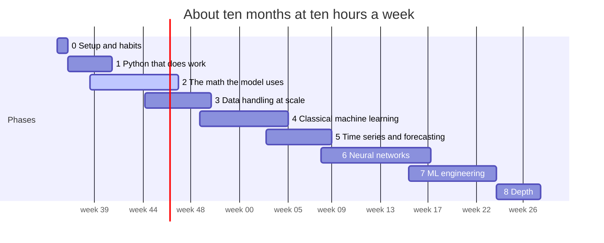

# Fremont ML Apprenticeship: from zero to designing the next model

_September 2026. Companion to `21_PLAN_M1_TRAFFIC_MODEL.md`; the stage numbers below refer to that plan's flowchart._

**Learn machine learning from nothing by building this traffic model, stage by stage, until you can design the next one yourself.**

For someone with no programming and rusty math, about ten hours a week, and this repository. The project is the syllabus: every topic appears the week a stage needs it, gets built once with a library and once from scratch, and ends with something that runs. By the end you understand every line in the repo, can rebuild each stage from a blank file, and have the foundations that being good at ML actually rests on: the math to read papers, the engineering to ship, and the judgement to evaluate honestly.

## At a glance

| | | |
|---|---|---|
| Hours a week | **10** | double it and the calendar roughly halves; the order does not change. |
| Calendar | **≈10 months** | nine phases, two of them running alongside others. |
| Stages built | **13** | every box in the pipeline flowchart, by your own hand. |
| Books and courses | **≈20** | almost all free; the two paid books are optional. |
| Rebuilt from scratch | **4** | logistic regression, the cleaning stage, an MLP with backprop, the evaluation. |
| Write-ups | **9** | one per phase; explaining is the test. |

_Hours are honest averages for a beginner. Faster is fine; skipping a checkpoint is not._

## The schedule

Solid bars are the main focus; the dashed bar runs alongside. Phase 8 is open-ended.

| Phase | Weeks | Hours | Builds |
|---|---|---|---|
| 0 · Setup and habits | 0–1 | ≈8 h | stage 2 runs |
| 1 · Python that does work | 1–5 | ≈40 h | stage 2, rebuilt |
| 2 · The math the model uses | 3–11 (alongside) | ≈60 h | stage 3 from a blank file |
| 3 · Data handling at scale | 8–14 | ≈50 h | stage 5 for real |
| 4 · Classical machine learning | 13–21 | ≈70 h | stages 6, 7, 9, 10 |
| 5 · Time series and forecasting | 19–25 | ≈45 h | stage 8 targets, stage 11 episodes |
| 6 · Neural networks | 24–34 | ≈80 h | stage 9 networks |
| 7 · ML engineering | 32–40 | ≈50 h | stages 12 and 13 |
| 8 · Depth | 40–44 | open-ended | papers, PEMS-BAY, write-ups |

## The path

### Six rules

- **The project is the syllabus.** Every topic is here because a stage needs it, and you learn it the week you build that stage. Nothing is studied 'just in case' until phase 8.
- **Build it twice.** First with the library, so it works. Then the core from scratch in numpy, the way `03_train_from_scratch.py` does, so you know what the library hides. Then back to the library, faster.
- **Evaluate before you model.** Baselines, metrics and leakage come before any algorithm past logistic regression. A number without a baseline next to it is not a result.
- **Math just in time.** Linear algebra, calculus and probability in the amounts the stage needs, derived once by hand. Depth comes in phase 8, when you know what it is for.
- **Write it down.** A lab notebook every week, a README per stage, a write-up per phase. If you cannot explain it in plain words you do not have it yet.
- **Checkpoints are things that run.** Each phase ends with code that produces a number or a file, not with a quiz.

### What really good looks like

The seven things the plan is aiming at. Phase 8 is where the last two are earned; the first five come from building the pipeline.

- **Framing.** Turn a fuzzy question ('will traffic be bad?') into a unit, a target, a horizon and a metric, and say what the answer cannot mean.
- **Data.** Build the pipeline from raw files, know its failure modes (time zones, imputation, duplicates, gaps), and measure its memory and time.
- **Models.** Know a dozen models well enough to say which wins on which data and why, and to implement the core of any of them from a paper.
- **Evaluation.** Design a split that cannot leak, pick metrics the imbalance cannot fool, put a baseline next to every number, and calibrate what you ship.
- **Engineering.** Ship one implementation used by training and serving, schedule it, monitor it, retrain it, and roll it back.
- **Reading.** Read a new paper in an evening and say what it would change in stage 9 and what it would not fix.
- **Explaining.** Describe all of the above to a smart person outside the field without hiding behind jargon.

### Honest notes

- Editions and chapter numbers drift; if a chapter does not match its description, find the topic in the index. Availability of free editions can change.
- The hours assume a beginner. If phase 1 takes twenty hours, take the twenty; if it takes sixty, that is normal too. Reorder nothing.
- The math in phase 2 is the part people skip and the part that separates using ML from understanding it. Derive the gradient once by hand; everything in phase 6 is that derivation repeated.
- Being good at ML is mostly being good at evaluation. Phases 4 and 5 are where that is learned; do not shorten them to reach the neural networks sooner.

## Nine phases

### Phase 0 · Setup and habits

_weeks 0–1 · ≈8 h · builds: stage 2 runs_

**Goal.** A working machine and a working routine.

**Learn.**

- The terminal: `cd`, `ls`, `cat`, `head`, pipes, environment variables.
- Git: clone, branch, commit, push, diff, `.gitignore`; what a repository and a README are.
- Native arm64 Python on Apple silicon (miniforge or python.org), virtual environments, `pip`, VS Code, Jupyter.
- The shape of this repo: the numbered scripts, `data/`, `models/`, `.env`, and why secrets never get committed.

**Read and watch.**

- Software Carpentry: The Unix Shell, Version Control with Git · _free, half a day each, exactly the commands you will use_
- Pro Git, chapters 1–3 · _free online; enough Git for a year_
- The repo's own `00_CONCEPTS.md` and `05_PLAN_COMBINED_DATASETS.md` · _read them once now, again in phase 4_

**Build.**

- Clone Traffic1, create the venv, install the requirements, get a 511 key, run `02_collect_events.py` and open the CSV.
- Add `data/` and `.env` to `.gitignore`, commit, push. Start `notebook/2026-W37.md` with what you did and what confused you.

**Done when.**

- You can say in one sentence what each file in the repo root is for.
- One commit of yours is on GitHub, and `.env` is not in it.

**Pitfalls.**

- Rosetta Python, which runs at half speed and breaks some wheels.
- Reading about tools instead of typing the commands.

### Phase 1 · Python that does work

_weeks 1–5 · ≈40 h · builds: stage 2, rebuilt_

**Goal.** Read and write the collector scripts fluently.

**Learn.**

- Variables, numbers, strings, lists, dicts, sets, tuples; `if`, `for`, `while`; functions, arguments, return values, scope.
- Modules and imports, files, CSV and JSON, exceptions, `requests`, `argparse`, f-strings, comprehensions.
- Dates and time zones with `datetime` and `zoneinfo`; what UTC is and why the log stores it.
- The debugger, print-debugging with intent, and `pytest` for small functions.

**Read and watch.**

- Automate the Boring Stuff with Python, chapters 1–13 and 16–18 · _free online; practical from page one_
- The official Python tutorial, sections 3–9 · _free; the reference once Sweigart runs out_
- Kaggle Learn: Python · _free, short, with exercises in the browser_
- The `zoneinfo` and `datetime` documentation · _free; read the section on aware versus naive datetimes twice_

**Build.**

- Read `02_collect_events.py` top to bottom and write one comment above each function saying what it does and why.
- Rewrite `event_touches_fremont()` from its description without looking, then test it with pytest on five hand-made events (one on I-880 with no coordinates, one inside the box on an unnamed road, one outside both).
- Write a script that prints events per road per day from the CSV, using only the standard library.
- Make the stage 2 change from the plan: record `first_seen_at` and `last_seen_at` per event id, and write each poll's raw JSON to `data/events_raw/`.

**Done when.**

- Your filter passes your tests and the repo's behaviour is unchanged for real events.
- You can explain why `created` is a string in the CSV and where it must become a datetime.

**Pitfalls.**

- Tutorial hell: watching without typing. Every chapter ends with you closing the book and writing the code.
- Skipping tests because the script 'obviously works'.

### Phase 2 · The math the model uses

_weeks 3–11, alongside phases 1 and 3 · ≈60 h · builds: stage 3 from a blank file_

**Goal.** Follow every symbol in `00_CONCEPTS.md` and `03_train_from_scratch.py`, and derive the update rule yourself.

**Learn.**

- Linear algebra: vectors, dot product, matrix times vector, matrix times matrix, transpose, norms; what `x @ weights + bias` computes for a whole batch; a linear model as a hyperplane.
- Calculus: the derivative as a slope, the chain rule, partial derivatives and the gradient; why stepping against the gradient lowers the loss; derivatives of the sigmoid and the log.
- Probability: random variables, Bernoulli and normal distributions, expectation, variance, conditional probability and Bayes, independence; the logistic function as a probability.
- Statistics: mean, median and percentiles (the label uses a median; free flow is an 85th percentile), sampling, the law of large numbers, confidence intervals, what a p-value is and is not, correlation versus causation.
- Putting it together: binary cross-entropy from maximum likelihood, and its gradient for logistic regression, then the same lines in the code.

**Read and watch.**

- Khan Academy: Linear algebra, Differential calculus, Statistics and probability · _free; do the exercises, skip nothing marked 'gradient'_
- 3Blue1Brown: Essence of linear algebra, Essence of calculus · _free; the intuition the exercises lack_
- Mathematics for Machine Learning (Deisenroth, Faisal, Ong), chapters 2–7 · _free PDF; reference, not a read-through_
- Think Stats (Downey) · _free; statistics with Python from the first page_

**Build.**

- Derive the logistic regression gradient on paper, then check it numerically with finite differences against the repo's update.
- Write the training loop from a blank file and match the repo's weights to four decimals.
- Compute the median and the 85th percentile of a real speed column with numpy, by hand and with the library, and write a notebook page titled 'why the median' for stage 6.
- Plot the sigmoid and the log loss; explain in one paragraph why the loss is not squared error.

**Done when.**

- Your loop reproduces `bottleneck_weights.npz` and you can say what each weight means.
- You can derive the gradient on a whiteboard without notes.

**Pitfalls.**

- Trying to finish all of math first. This phase runs alongside phases 1 and 3 on purpose.
- Memorizing formulas you have not derived once.

### Phase 3 · Data handling at scale

_weeks 8–14 · ≈50 h · builds: stage 5 for real_

**Goal.** Build stage 5, the cleaning stage, on a real PeMS file, inside 2 GB.

**Learn.**

- numpy: arrays, dtypes, broadcasting, memory layout; why float32 halves everything.
- pandas: Series and DataFrame, indexing, `groupby`, `merge`, time indexes, `shift`, `rolling`, `resample`, categoricals, `read_csv` with `chunksize`, Parquet through pyarrow.
- Time zones and daylight saving in practice: `tz_localize`, ambiguous and nonexistent times.
- Data quality: missingness, bounds, duplicates, gaps, and PeMS's `% Observed` column.
- Plotting with matplotlib: line, histogram, scatter; reading a plot before trusting a number.
- Measuring memory and time; polars as a second, faster tool for the same job.

**Read and watch.**

- Python for Data Analysis, 3rd edition (McKinney), chapters 4–8 and 10–11 · _free online; the pandas book by pandas's author_
- pandas user guide: Time series and date functionality · _free; the `shift` and `rolling` semantics live here_
- Kaggle Learn: Pandas, Data Cleaning, Data Visualization · _free, short_
- The polars user guide, first three chapters · _free; do stage 5 once in each_

**Build.**

- Run stage 4 for a few days of files. Open one, confirm the column layout against the documented one, and write it into the stage 5 README.
- Write `10_clean_pems.py`: chunked reading, the Fremont station filter from the meta file, DST-safe UTC conversion, bounds, `% Observed`, forward fill of at most three steps, the full 5-minute grid, float32, monthly Parquet.
- Build the station registry with upstream and downstream neighbors from postmiles.
- Plot one station for a day and a week; you should see two rush hours on weekdays and none on Sunday.
- Write `tests/test_clean_pems.py` on a 100-row fixture, including the November repeated hour.
- Log memory and seconds per file; redo it in polars and compare.

**Done when.**

- One month of Fremont Parquet exists with the plan's schema and the plot shows rush hours.
- The DST test passes and the script stays under 2 GB.

**Pitfalls.**

- Loading a whole district-day at once.
- `object` dtypes and naive timestamps.
- Forward-filling across a station boundary, which invents data.

### Phase 4 · Classical machine learning

_weeks 13–21 · ≈70 h · builds: stages 6, 7, 9, 10_

**Goal.** Labels, the incident join, baselines, logistic regression, gradient boosted trees, calibration, and honest row-level evaluation.

**Learn.**

- The supervised setup: features, target, train, validation, test, and why three.
- Overfitting, bias and variance, regularization, early stopping.
- Metrics: confusion matrix, precision, recall, F1, the precision-recall curve and average precision, ROC-AUC, log loss, Brier score, reliability diagrams; why accuracy lies under imbalance.
- Leakage in its three forms: target, temporal, group. Class weighting.
- Linear and logistic regression with scikit-learn; decision trees; random forests; gradient boosting, and what `num_leaves`, `learning_rate` and `min_data_in_leaf` do in LightGBM; categorical handling.
- Feature engineering as hypothesis-making; feature importance and SHAP values.
- Isotonic and Platt calibration; choosing a threshold from a curve; hyperparameter search with a budget.

**Read and watch.**

- Machine Learning Specialization (Andrew Ng), courses 1 and 2 · _the classic; audit for free_
- An Introduction to Statistical Learning with Python (ISLP), chapters 2–4 and 8 · _free PDF; the clearest account of trees and boosting_
- Hands-On Machine Learning (Géron), chapters 1–7 · _paid; the practitioner's companion, worth owning_
- Kaggle Learn: Intro to ML, Intermediate ML, Feature Engineering · _free_
- LightGBM documentation: Parameters, Parameters Tuning · _free; read before touching a parameter_
- Interpretable Machine Learning (Molnar), the SHAP chapter · _free online_
- scikit-learn user guide: Model evaluation, Probability calibration · _free; the metrics you will report_

**Build.**

- `11_build_labels.py` with the train-only profile and both labels; `12_join_incidents.py` with distance and upstream flags.
- `14_train_baselines.py`: persistence, profile rate, ratio rule.
- `15`: your numpy logistic regression and `sklearn.linear_model.LogisticRegression` on the same standardized features; they must agree.
- `16`: LightGBM per horizon with early stopping on validation average precision; `16b`: isotonic calibration and thresholds.
- The row-level half of `18_evaluate_lead_time.py` with reliability bins, and a SHAP summary for one horizon.
- A leakage experiment: shuffled split versus chronological split on the same features; write down the gap and why it exists.

**Done when.**

- One table: persistence, profile rate, logistic, LightGBM, three horizons, chronological validation.
- A reliability diagram near the diagonal after calibration.
- You explained every number in that table to someone else, and they could repeat it.

**Pitfalls.**

- Judging by accuracy.
- Tuning on the test split, even once.
- Celebrating an AUC that persistence also gets.

### Phase 5 · Time series and forecasting

_weeks 19–25 · ≈45 h · builds: stage 8 targets, stage 11 episodes_

**Goal.** Make the model forecast, and evaluate it as a forecast.

**Learn.**

- Autocorrelation and the ACF; stationarity, trend, seasonality (daily and weekly here).
- Lag and rolling features done right; the forecast horizon; direct versus recursive multi-horizon strategies.
- Persistence and seasonal-naive baselines; rolling-origin backtests; leakage through time.
- ARIMA and exponential smoothing at reading level: what they are, why trees on lag features replaced them for this problem.
- Spatial correlation and the road graph; propagation of a jam upstream.
- Event-level metrics: episode onset, lead time, false alarms per station-day; anomaly versus level, the two labels.

**Read and watch.**

- Forecasting: Principles and Practice, the Python edition (Hyndman, Athanasopoulos), chapters 1–5, 7, 9 · _free online; the forecasting book_
- Kaggle Learn: Time Series · _free; lag features and hybrids in an afternoon_
- statsmodels documentation: one ARIMA fit on one station · _free; do it once to know what it is_

**Build.**

- `13_feature_engineering.py` with forward-shifted targets `y_15`, `y_30`, `y_60` and the rolling-origin split with a one-day gap.
- The episode-level half of `18_evaluate_lead_time.py`: onset, lead-time histogram, share of episodes caught, false alarms.
- Plot the ACF of speed for one station; compute skill over persistence per horizon.
- Train on the absolute label too; compare prevalence and skill and write the decision.

**Done when.**

- A lead-time histogram and one sentence per horizon on skill over persistence.
- A written decision on which label the product means, with numbers.

**Pitfalls.**

- `shift` in the wrong direction; a rolling window that looks ahead.
- Evaluating on rows whose target was imputed.

### Phase 6 · Neural networks

_weeks 24–34 · ≈80 h · builds: stage 9 networks_

**Goal.** The MLP in numpy with backprop by hand, then the spatio-temporal net in PyTorch on the M1's GPU.

**Learn.**

- The perceptron and the multilayer perceptron; activations; loss functions; backpropagation for one hidden layer, by hand.
- Gradient descent variants (SGD, momentum, Adam); initialization; batch normalization, dropout, learning-rate schedules; early stopping.
- PyTorch: tensors, autograd, `nn.Module`, `DataLoader`, the `mps` device, saving and loading, `model.eval()`.
- Sequence models: RNN, GRU, LSTM, 1-D temporal convolutions; attention and transformers at reading level.
- Graph neural networks: adjacency, message passing, diffusion on a graph; how DCRNN and STGCN model traffic on PeMS data.
- The practical rules: small data wants small nets; a deep model does not win by default.

**Read and watch.**

- 3Blue1Brown: Neural networks · _free; four videos, watch before Karpathy_
- Neural Networks: Zero to Hero (Karpathy), micrograd and makemore · _free; backprop from scratch, the best there is_
- PyTorch tutorials: Learn the Basics; the MPS backend notes · _free_
- Dive into Deep Learning (d2l.ai), chapters 3–5 and 9–10 · _free, PyTorch throughout_
- Practical Deep Learning for Coders (fast.ai) · _free; the practitioner's counterweight to the theory_
- DCRNN (Li et al., ICLR 2018) and STGCN (Yu et al., IJCAI 2018) · _the two traffic papers; first pass now, second in phase 8_

**Build.**

- `17a`: a numpy MLP with a hand-written backward pass checked against finite differences.
- The same MLP in PyTorch with matching loss curves.
- `17b`: the spatio-temporal net on MPS with the registry's road graph; a CPU versus MPS timing table.
- Put its validation number next to LightGBM's and apply the plan's 0.02 rule.

**Done when.**

- Your backward pass matches autograd to 1e-6.
- The net trains without NaN, early-stops, and sits in the report next to the trees.
- You can draw its data flow from memory.

**Pitfalls.**

- float64 on MPS.
- Forgetting `model.eval()` at prediction time.
- A learning rate ten times too high.
- Believing the deep model must win.

### Phase 7 · ML engineering

_weeks 32–40 · ≈50 h · builds: stages 12 and 13_

**Goal.** The pipeline runs itself on the Mac mini, and you could hand it to someone.

**Learn.**

- Reproducibility: seeds, pinned versions, a Makefile, one command from raw to report.
- The one-feature-module rule and train-serve skew; testing ML code with fixtures and golden files.
- Experiment tracking (a JSON log per run, or MLflow locally); a model registry as a folder with a manifest; rollback.
- Scheduling with launchd; logging; alerting when nothing arrives.
- Monitoring: drift with PSI, performance decay, retraining policy; delivered lead versus nominal lead.
- Memory profiling on unified memory; documentation for the next person; what a false alarm costs a real driver.

**Read and watch.**

- Designing Machine Learning Systems (Huyen), chapters 1–3 and 7–9 · _paid; the systems view in one book_
- Made With ML (Mohandas) · _free; testing, monitoring and pipelines with code_
- Machine Learning Engineering (Burkov) · _free to read online_
- Hidden Technical Debt in Machine Learning Systems (Sculley et al., 2015) · _free; ten pages, read twice_
- launchd.info and the pytest documentation · _free_

**Build.**

- `19_predict_live.py` in replay mode over yesterday's file; `20_monitor.py`; four launchd plists.
- `make setup` and `make all` that rebuild features, models and the report from raw.
- A golden-file test: serving features equal training features for one stored day, bit for bit.
- A memory and time line in every stage's log; a README per stage.

**Done when.**

- From a fresh clone, `make setup && make all` produces the evaluation report.
- The replay loop has run unattended for a week and the monitor has written four weekly files.

**Pitfalls.**

- A second copy of the feature code.
- cron instead of launchd on a Mac that sleeps.
- No way to roll back a bad model.

### Phase 8 · Depth

_weeks 40–44, then onward · open-ended · builds: papers, PEMS-BAY, write-ups_

**Goal.** From 'can build this' to 'can design the next one and say why it works'. Rotate the tracks; each is months, not weeks.

**Learn.**

- Uncertainty: Bayesian thinking, quantile regression, conformal prediction for honest intervals on 'slow in 30 minutes'; causal inference basics, and why incident features are not causal claims.
- Theory: convexity, why boosting works, generalization and the bias-variance decomposition properly; CS229 notes; Elements of Statistical Learning chapters 7, 10 and 15.
- Deep learning depth: transformers properly, attention for time series, graph learning (CS224W), self-supervision; Goodfellow as the reference.
- Benchmarks: reproduce DCRNN or Graph WaveNet on METR-LA and PEMS-BAY, the public PeMS Bay Area datasets, with a reduced config on the M1; compare with the Fremont numbers.
- Practice: two Kaggle competitions on tabular or time-series data, written up honestly; one contribution to a library you used (a docs fix counts).
- Communication: publish a write-up of this project with its limitations; give a talk to a meetup or a friend.

**Read and watch.**

- Probabilistic Machine Learning: An Introduction (Murphy) · _free PDF; the modern reference_
- The Elements of Statistical Learning (Hastie, Tibshirani, Friedman) · _free PDF_
- CS229 lecture notes (Stanford) · _free_
- CS224W: Machine Learning with Graphs (Stanford) · _free lectures_
- A Gentle Introduction to Conformal Prediction (Angelopoulos, Bates) · _free; intervals you can defend_
- Statistical Rethinking (McElreath) · _paid; the Bayesian track, lectures free_
- Deep Learning (Goodfellow, Bengio, Courville) · _free online_
- Graph WaveNet (Wu et al., IJCAI 2019) · _free; the third traffic paper_

**Build.**

- A PEMS-BAY reproduction that runs on the mini.
- A conformal interval on the 30-minute prediction, evaluated for coverage.
- A public write-up of the Fremont model, limitations first.

**Done when.**

- You read a new traffic-forecasting paper in an evening and say what it would change in stage 9 and what it would not fix.
- The write-up is public and someone else has run your code.

**Pitfalls.**

- Collecting courses.
- Never finishing a write-up.
- Optimizing a leaderboard instead of understanding.

## How to study so it sticks

- **A weekly rhythm at ten hours.** Three hours of reading or lectures with notes. Five hours building in the repo. One hour rewriting the week's notes from memory. One hour explaining it to someone, or to a file if no one is around.
- **The three passes.** Run it. Change it and predict what will happen before you run it. Rebuild it from a blank file. Only the third pass counts as knowing.
- **A lab notebook.** `notebook/YYYY-WW.md`: what you tried, what broke, what you learned, the number. Numbers without the setup that produced them are noise a month later.
- **A baseline next to every result.** Persistence, the profile rate, the previous version. No exceptions, including for plots.
- **What would fool this metric?.** Ask it of every number. Accuracy under imbalance, AUC with persistence, F1 without a threshold rule, a shuffled split on a time series.
- **Read in this order.** Code, then docs, then papers, then blog posts. Blog posts last because they are the easiest to write badly.
- **The stuck rule.** Thirty minutes alone. Then write the question down precisely, which solves half of them. Then ask, with the exact error and what you already tried.
- **One project.** This one is enough for ten months. A second project before phase 7 is a way to avoid finishing the first.
- **Rest.** Two long sessions beat five short ones for building; five short ones beat two long ones for math. Sleep is when it consolidates.

## Books and courses, in order of use

| Title | By | Cost | Phase |
|---|---|---|---|
| The Unix Shell; Version Control with Git | Software Carpentry | free | 0 |
| Pro Git | Chacon, Straub | free | 0 |
| Automate the Boring Stuff with Python | Sweigart | free online | 1 |
| The Python tutorial | python.org | free | 1 |
| Kaggle Learn micro-courses | Kaggle | free | 1, 3, 4, 5 |
| Khan Academy: linear algebra, calculus, statistics | Khan Academy | free | 2 |
| Essence of linear algebra; Essence of calculus; Neural networks | 3Blue1Brown | free | 2, 6 |
| Mathematics for Machine Learning | Deisenroth, Faisal, Ong | free PDF | 2 |
| Think Stats | Downey | free | 2 |
| Python for Data Analysis, 3rd ed. | McKinney | free online | 3 |
| pandas and polars user guides | project docs | free | 3 |
| Machine Learning Specialization | Ng, DeepLearning.AI | free to audit | 4 |
| An Introduction to Statistical Learning with Python | James, Witten, Hastie, Tibshirani, Taylor | free PDF | 4 |
| Hands-On Machine Learning | Géron | paid | 4 |
| LightGBM documentation | Microsoft | free | 4 |
| Interpretable Machine Learning | Molnar | free online | 4 |
| scikit-learn user guide | project docs | free | 4 |
| Forecasting: Principles and Practice, Python edition | Hyndman, Athanasopoulos | free online | 5 |
| Neural Networks: Zero to Hero | Karpathy | free | 6 |
| PyTorch tutorials | PyTorch | free | 6 |
| Dive into Deep Learning | Zhang, Lipton, Li, Smola | free | 6 |
| Practical Deep Learning for Coders | fast.ai | free | 6 |
| DCRNN; STGCN; Graph WaveNet | Li et al. 2018; Yu et al. 2018; Wu et al. 2019 | free | 6, 8 |
| Designing Machine Learning Systems | Huyen | paid | 7 |
| Made With ML | Mohandas | free | 7 |
| Machine Learning Engineering | Burkov | free online | 7 |
| Hidden Technical Debt in Machine Learning Systems | Sculley et al. 2015 | free | 7 |
| Probabilistic Machine Learning: An Introduction | Murphy | free PDF | 8 |
| The Elements of Statistical Learning | Hastie, Tibshirani, Friedman | free PDF | 8 |
| CS229 notes; CS224W lectures | Stanford | free | 8 |
| A Gentle Introduction to Conformal Prediction | Angelopoulos, Bates | free | 8 |
| Statistical Rethinking | McElreath | paid, lectures free | 8 |
| Deep Learning | Goodfellow, Bengio, Courville | free online | 8 |
